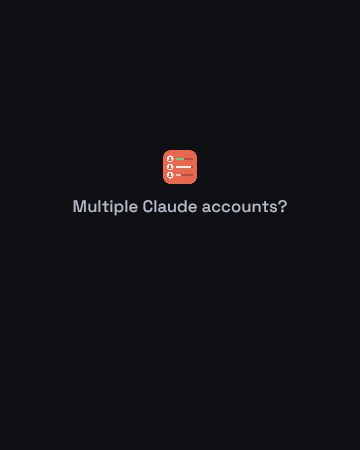

# Claude Auto Switch

**Auto switch your Claude accounts, and stop thinking about which one is active.**
The extension watches every account's limits and moves Claude Code to the next account by itself —
starting with the one whose weekly limit resets soonest, because capacity you don't spend before a
reset is gone. Switching by hand, live limits for every account, usage analytics and an
availability calendar come with it.

> **Note:** Not affiliated with, endorsed by, or supported by Anthropic.

## What it does

- **Switches accounts for you.** The account whose weekly limit resets soonest is kept active, and
  the extension hands over as soon as another account takes that place — or only when the active
  one runs out, if you prefer a pure failover.
- **Checks before it commits.** The chosen account's usage is read again right before the switch,
  and an account that turns out to be spent, expired or busy elsewhere is skipped and reconsidered
  on the next round.
- **Leaves you in charge of each account.** Exclude one from automation, give one its own
  hand-over percent, or hold one active and pause automation entirely.
- **Shows every account's limits, live.** The 5-hour, weekly, and model-specific (e.g. Fable)
  windows, each with the time until it resets. Same data as Claude Code's `/usage`.
- **Keeps logins alive.** Tokens are refreshed exactly the way Claude Code refreshes them, under
  its own lock, so neither side is ever left holding a spent token.
- **Tells you what you actually used.** Analytics show how much of each limit's capacity you spent
  before it reset; the calendar shows when each account was, and will be, usable.
- **One window per account**, when you want to run two accounts side by side.
- **Private by design.** No telemetry. Network requests go only to Anthropic, and saved accounts
  stay in VS Code's encrypted SecretStorage.

## Install

1. Download the latest `.vsix` from
   [Releases](https://github.com/solomon-ochepa/claude-auto-switch/releases/latest).
2. **VS Code:** `code --install-extension claude-auto-switch-<version>.vsix`, or
   **Extensions: Install from VSIX…** in the command palette.
3. **VSCodium, Cursor and other editors** take the same file.

Install it from inside the editor, not by double-clicking the file in Explorer: that may open
Visual Studio's installer, which cannot install VS Code extensions. **Requires** VS Code 1.85 or
newer on Windows, macOS, or Linux.

## Getting started

1. Log in to Claude Code with your first account. It is **saved automatically** — the panel shows
   it with an offer to rename it. (`autoSaveNewAccounts` turns that off, leaving a **Save** button.)
2. Open the **Claude Auto Switch** panel from the activity bar, click **Add account**, and log in
   with another account. That one is saved on its own too, and the current account stays active.
3. That's it — automation is on by default. The panel lists accounts next-to-be-used first, and
   `Claude: Show the auto-switch log` says what it decided and why.
4. Switching replaces Claude Code's login, so **the window is reloaded afterwards**. The extension
   asks; `autoReloadAfterSwitch` does it without asking.

> **Never use `/logout` to change accounts.** It revokes that login on Anthropic's side, and the
> saved copy dies with it. Use **Switch**, **Add account**, or `/login` instead.

## Auto-switch

On by default; `autoSwitch.enabled` turns it off. A round runs after every usage check, when a
used-up limit resets, at startup, and on demand via
`Claude: Switch to the next account now (auto-switch)`.

### How it picks

- **The nearest weekly reset goes first.** Capacity that isn't used before a limit resets is lost,
  so the account whose weekly (7-day) limit resets soonest is taken first. Only weekly dates
  count: the 5-hour window refills several times a day, so it says nothing about which account to
  spend this week, and it is kept out of both the order and the tie-break between accounts sharing
  a reset date. Those are separated by how much of the *weekly* limit is left.
- **`autoSwitch.order` offers other rules:** the soonest reset of any limit (the 5-hour window
  included), the capacity that would be lost soonest, the most usage left, or your own list order.
- **`autoSwitch.when` decides when it acts.** `always` (the default) keeps the first account of
  that order active and hands over as soon as another takes its place. `exhausted` waits until the
  active account runs out of a limit.
- **Availability is confirmed, not assumed.** The chosen account's usage is fetched again right
  before the switch, and `autoSwitch.minAvailablePercent` sets how much of every limit it must
  still have.
- **A switch you make by hand sticks.** Switching to an account yourself holds it for
  `manualSwitchHoldMinutes` (60 by default) before the automation may move again, so your choice
  is not undone on the next round; the card shows the time left. The hold ends early if the
  account runs out of a limit, `0` turns it off, and the ★ button holds an account indefinitely.
- **An excluded account keeps the session.** Opting an account out means "do not pick me", not
  "take me away while I am working": it stays active until one of its limits (or its own
  hand-over limit) is reached.
- **A skipped account comes back.** One that turns out to be used up, whose login expired, that is
  in use in another window, or whose switch fails for any other reason is passed over and the next
  is tried. The skip lasts only until the next round, which confirms the account again and takes it
  as soon as it qualifies — the card shows **Skipped** with the reason meanwhile.
- **Every decision is logged** to the **Claude Auto Switch** output channel: the account taken, the
  one kept, or why none could be — `No other account is available; the first one is usable again in
  1 h.`

### Per-account controls

Each card's buttons and **⋯** menu decide how that account takes part.

| Control | Where | What it does |
| --- | --- | --- |
| **Keep active** | ★ button, first in the card's row | Holds this account: automation takes it and moves nowhere else, waiting rather than handing over when its limits run out. The star fills in and turns green. Beats the account's own opt-out, its hand-over limit and the minimum. One account at a time; click again to release. |
| **Hand-over limit** | **Set a hand-over limit…** in the **⋯** menu | A percent of your own: once any limit of this account reaches it, automation treats the account as spent and takes the next in the queue, without waiting for the limit to be used up. The card carries a shield badge with the percent. |
| **Exclude** | **Exclude from auto-switching** in the **⋯** menu | Never switched to automatically, and never taken away while it can still be used; marked **No auto-switch**. |

Holding an account that has already reached its own hand-over limit asks for a higher limit first,
so it stays a deliberate choice rather than an argument with a setting. If that limit is genuinely
used up, raising it would change nothing, so it asks to confirm instead and then waits for the
reset.

The panel follows the same order, so the account used next is at the top. Choosing a sort yourself
overrides that, and `autoSwitch.sortList` turns it off.

## The accounts panel

- **Accounts save themselves.** A login Claude Code starts using is saved as soon as it appears,
  with an offer to rename it; each login is attempted once, so a broken one can't nag. With
  `autoSaveNewAccounts` off, it waits in its own box behind a **Save** button instead.
  **Add account** logs in to another account without touching the current one.
- **Live usage limits** for the 5-hour, weekly and model-specific windows, with reset times.
- **Colors tell you the state.** The icon is green while an account has limit left, orange once a
  limit is used up, gray when usage is unknown. The name, and the active account in the status bar,
  is green while the account can start sessions and red once the 5h or the general weekly limit is
  used up — a used-up model limit such as Fable blocks only that model, so it stays green. A
  used-up limit's reset time is yellow under 10 minutes, orange under an hour, red beyond a day.
- **Filter and sort.** By text, availability, plan (Pro, Max, Team, …) or model limit; sort by the
  auto-switch order, availability, usage left, next reset, plan, name, or drag-and-drop.
- **Stays simple.** Filters, sorting and statistics appear once you have two accounts.
- **Status bar** with the active account and its usage. **Notifications** when a used-up limit is
  available again, with a **Switch** button.
- **Switch** on a card, the status bar, or `Claude: Switch account` moves accounts by hand at any
  time, and holds the account you picked (see `manualSwitchHoldMinutes`); **Undo last switch** puts
  the previous one back.

## Usage analytics

Turn on **Collect usage history** (on the analytics page or in settings) to record every account's
limits once a minute. Readings stay on this computer and are kept for 90 days by default.

Open **Show usage analytics** (the chart icon in the panel's title bar) to see:

- **Charts per limit** (5h, weekly, Fable, …) over 1 day, 1 week, 1 month, 3 months, all time, or a
  custom range. Show **Used %** or **Available %** as bar, stacked bar, line or area charts. Bars
  are green below 60% used, orange from 60%, red from 80%.
- **A shared legend** with a checkbox per account that shows or hides it in every chart.
- **Capacity utilization:** how much of the capacity each limit offered you actually used. A 5h
  limit refills every 5 hours and a weekly limit every 7 days, so whatever isn't used before a
  reset is lost. You get an overall figure, one per limit and per account, and charts over time.
- **By calendar period:** the same utilization grouped by weekday, hour of day, week or month, with
  the best and lowest periods called out.

Charts fold into a compact sparkline, show guide lines on hover, and refresh every 2 minutes.
**Delete collected usage history** removes all readings.

## Availability calendar

Open **Show account availability calendar** (the calendar icon in the title bar) to see when each
account can be used, across a week or hour by hour for a single day.

- Pick which limits to show. Each one gets its own lane per account.
- Green is available, amber is 80%+ used, red is limited, gray is no data. Markers show reset
  times, and a red line marks now.
- The past comes from collected usage history; the future is projected from the latest reading and
  drawn striped.
- Filter and sort as in the panel, and drag rows to reorder them.
- A **Right now** card per account shows its current state, how usable it was in the period, how
  often it ran out, and a **Switch** button.

## Logins that stay valid

- **Token refresh that plays nicely with Claude Code**, so you don't have to log in again every
  day. See [Token handling](#token-handling).
- **Browser login** works without the Claude Code CLI. **Reauthorize** repairs a broken saved login
  without touching the active account.
- **Independent windows** run the same project in separate VS Code windows, one account each. See
  [Parallel windows](#parallel-windows).
- **Backup and restore** the account list in a password-protected ZIP. See
  [Backup and restore](#backup-and-restore).

## Commands

| Command | What it does |
| --- | --- |
| `Claude: Switch account` | Pick an account, with its usage limits |
| `Claude: Switch to the next account now (auto-switch)` | Run one auto-switch round now |
| `Claude: Keep an account active (pause auto-switching)` | Hold one account until you release it |
| `Claude: Set an account's auto-switch hand-over limit` | Hand an account over at a percent of its own |
| `Claude: Include or exclude an account in auto-switching` | Opt an account in or out |
| `Claude: Show the auto-switch log` | Open the log of auto-switch decisions |
| `Claude: Save current account as profile` | Save the account Claude Code is logged in with |
| `Claude: Add another account (isolated login)` | Log in to another account without touching the current one |
| `Claude: Refresh accounts, current login and limits` | Re-read everything now |
| `Claude: Refresh usage limits` | Re-read usage limits now |
| `Claude: Show accounts panel` | Open the accounts panel |
| `Claude: Show usage analytics` | Open the analytics page |
| `Claude: Show account availability calendar` | Open the availability calendar |
| `Claude: Open independent account window` | Open this project in a new window for one account |
| `Claude: Log in from terminal (replaces the current account)` | Run `claude auth login` (or browser login without the CLI) |
| `Claude: Authorize in browser (without CLI)` | Log in through the browser |
| `Claude: Reauthorize account profile` | Log a saved account in again, without touching the active one |
| `Claude: Complete profile reauthorization` | Finish a reauthorization |
| `Claude: Undo last switch` | Restore the previous account |
| `Claude: Rename account profile` / `Remove account profile` | Manage saved accounts |
| `Claude: Back up account list (password-protected ZIP)` | Save all accounts to an encrypted ZIP |
| `Claude: Restore account list from backup` | Merge a backup into the list |
| `Claude: Delete collected usage history` | Remove all usage readings |
| `Claude: About Claude Auto Switch` | Version, author and project information |

## Settings

All settings start with `claudeAutoSwitch.`, and the Settings editor groups them under
**Auto-switch**, **Accounts and limits**, **Switching**, **Usage history** and **Claude Code**.

### Auto-switch

| Setting | Default | Description |
| --- | --- | --- |
| `autoSwitch.enabled` | `true` | Change accounts on its own |
| `autoSwitch.when` | `always` | `always` keeps the first account of the order active; `exhausted` only switches once the active account runs out |
| `autoSwitch.order` | `weeklyReset` | Which account comes first: `weeklyReset`, `anyReset`, `urgency`, `remaining` or `listOrder` |
| `autoSwitch.minAvailablePercent` | `1` | How much (%) of every limit an account must have left to be switched to |
| `autoSwitch.notify` | `true` | Notify which account it moved to, and why |
| `autoSwitch.sortList` | `true` | Sort the panel by the auto-switch order, next account first |

### Accounts and limits

| Setting | Default | Description |
| --- | --- | --- |
| `autoRefresh` | `true` | Check all accounts' usage limits regularly |
| `pollIntervalSeconds` | `240` | Seconds between checks (minimum 60; short intervals with many accounts can hit rate limits) |
| `requestDelaySeconds` | `2` | Pause between requests to Anthropic; accounts are checked one at a time, never in parallel |
| `notifyOnLimitReset` | `true` | Notify when a used-up limit is available again |
| `warnThresholdPercent` | `80` | Usage bars and the status bar turn red from this percent, and orange from 75% of it |

### Switching

| Setting | Default | Description |
| --- | --- | --- |
| `autoSaveNewAccounts` | `true` | Save a Claude Code login as an account as soon as it appears |
| `manualSwitchHoldMinutes` | `60` | Minutes an account you switch to by hand is held before auto-switching may move again (`0` = no hold) |
| `autoReloadAfterSwitch` | `false` | Reload the window automatically after switching |

### Usage history

| Setting | Default | Description |
| --- | --- | --- |
| `usageHistory.enabled` | `false` | Collect usage history for analytics and the calendar |
| `usageHistory.intervalSeconds` | `60` | Seconds between usage readings (minimum 60) |
| `usageHistory.retentionDays` | `90` | Days of usage history to keep |

### Claude Code

| Setting | Default | Description |
| --- | --- | --- |
| `credentialsPath` | `""` | Custom path to `.credentials.json` (empty means `~/.claude/.credentials.json`). On macOS its folder selects Claude Code's Keychain item |
| `claudeCommand` | `claude` | The Claude Code CLI command; use the full path if VS Code can't find it |
| `sayHiModel` | `haiku` | Model used for Say Hi warmups |
| `sayHiPrompt` | `Hi` | Prompt used for Say Hi warmups |
| `sayHiTimeoutSeconds` | `120` | How long a Say Hi warmup may take |

## How it works

- **Switching** replaces Claude Code's stored login and the cached account in `~/.claude.json`. The
  login is `~/.claude/.credentials.json` on Windows and Linux, and the `Claude Code-credentials`
  item in the login Keychain on macOS. A backup copy makes the switch undoable. Saved accounts are
  kept in VS Code's encrypted SecretStorage.
- **Usage** comes from Anthropic's unofficial usage endpoint, the same source as `/usage`. Because
  it is rate-limited, checks run every 240 seconds by default, plus any manual refresh. Accounts
  are checked one at a time with a 2-second pause between requests (`requestDelaySeconds`), and an
  account that still gets a rate-limit error is paused for 5 minutes.

### Token handling

Claude Code's refresh tokens work only once: each refresh issues a new token and invalidates the
old one. If two programs share a login and one of them refreshes, the other is logged out. To
prevent this, the extension:

- takes Claude Code's own refresh lock before refreshing, so Claude Code waits and picks up the new
  token;
- writes every new token back to all local copies and to the saved account;
- always uses the newest token it can find, and refreshes only when the current one is expiring;
- watches Claude Code's stored login (`.credentials.json`, or the Keychain on macOS) and picks up
  its own refreshes immediately;
- saves the account you switch away from first, so it keeps its latest token;
- never retries a token the server has rejected.

Each login is independent, so logging in on another computer doesn't affect this one. Saved accounts
are stored per machine: add them on each computer, or move them with a backup.

### Parallel windows

By default, all VS Code windows share one Claude Code login. **Open independent account window** (or
the **Window** item on a card) opens the project in a new window with its own config directory
through `CLAUDE_CONFIG_DIR`, so you can run one window per account. The extension won't open a
second window for the same account, because both would spend the same refresh token.

### Backup and restore

**Back up** and **Restore** live in the panel's **⋯** menu. The backup is a ZIP encrypted with
AES-256 and your password, so 7-Zip can open it too. It also stores your panel choices and settings
(except `credentialsPath`).

- **It contains login tokens.** Anyone with the file and the password can use those accounts.
- Restoring merges into the current list: it adds missing accounts and uses the backup's tokens only
  when they are newer.
- Tokens in an old backup may already be spent. Use **Reauthorize** on those accounts.
- Don't use the same restored account on two machines at once.

## Troubleshooting

**Nothing switched.** Open `Claude: Show the auto-switch log`: every round says what it decided.
`stay` means the active account is still the one the order wants; `wait` names what it is waiting
for; `failed` names the account that refused and why.

**`claude` is not recognized.** The CLI is optional — switching, usage checks and browser login
work without it, and only logging in from the terminal needs it.

1. Run `where claude` in PowerShell or CMD (`which claude` on macOS and Linux).
2. If it's found, restart VS Code so it picks up the updated PATH.
3. If it isn't, install it. Windows: `irm https://claude.ai/install.ps1 | iex`. macOS and Linux:
   `curl -fsSL https://claude.ai/install.sh | bash`
4. If VS Code still can't find it, set `claudeCommand` to the full path, e.g.
   `C:\Users\you\AppData\Roaming\npm\claude.cmd` or `/Users/you/.local/bin/claude`.

**macOS Keychain.** Claude Code keeps its login in the login Keychain. If switching reports that the
Keychain could not be read or updated, unlock the login keychain in Keychain Access and try again.

**Still stuck?** Open an [issue](https://github.com/solomon-ochepa/claude-auto-switch/issues) — the
templates ask for the version and the auto-switch log, which is usually enough to find the cause.
Never paste tokens or credentials; they are not needed. **Report a problem** in the panel's About
sheet goes to the same place.

## Privacy and security

- **No telemetry.** The extension collects no data and sends nothing to its author, publisher or any
  third-party server.
- **Network requests go only to Anthropic**, for token refresh, usage limits and identifying an
  account (`/api/oauth/profile`, the same call Claude Code makes after login).
- **Credentials stay local.** Saved accounts are kept in VS Code's encrypted SecretStorage.
  Credentials are written only to local Claude Code config folders and are never logged.
- Anyone with access to your user profile can read Claude Code's credential files, so protect your
  computer account.
- Use it only with **your own** accounts. The usage endpoint and the token refresh are unofficial
  and may change on Anthropic's side at any time.

## Development

Source: [github.com/solomon-ochepa/claude-auto-switch](https://github.com/solomon-ochepa/claude-auto-switch).
Requires [Node.js](https://nodejs.org/) 18+ and VS Code 1.85+. Run `npm install` first.

| Script | What it does |
| --- | --- |
| `npm run compile` / `watch` | Development build, once or on every change |
| `npm run package` | Minified production build |
| `npm run typecheck` | Type-check with `tsc` (the build itself doesn't) |
| `npm run test:smoke` | Run the tests |
| `npm run build:vsix` | Build the installable `.vsix` |
| `npm run install:vsix` | Install the built `.vsix` into VS Code |
| `npm run deploy` | Build and install in one step |

- **Run and debug:** open the folder and press **F5** to start an Extension Development Host. Run
  **Developer: Reload Window** there after changes, and **Developer: Open Webview Developer Tools**
  to debug the pages. The development host uses your real Claude credentials, so be careful with
  Switch, Remove and logins.
- **Webview code:** `webview/*.js` is bundled into `dist/webview/`, so rebuild after editing it.
  Shared logic lives in `src/`; the ranking rules are plain functions in `src/autoSwitch.ts`, with
  tests in `test/smoke.ts`.

### Releasing

1. Update `CHANGELOG.md` and the version in `package.json`.
2. `npm run prepublish:check` (type check + tests), then `npm run build:vsix`.
3. Tag the commit `v<version>` and attach the `.vsix` to a GitHub release.

Publishing to the VS Code Marketplace or [Open VSX](https://open-vsx.org/) additionally needs a
publisher account and a token (`vsce publish`, `ovsx publish`); neither is set up yet, so releases
are `.vsix` downloads.

## Credits

Maintained by [Solomon Ochepa](https://github.com/solomon-ochepa).

Forked from [tursoft/account-manager-for-claude](https://github.com/tursoft/account-manager-for-claude)
by Muhammet Tursak, which redesigned the panel and added usage analytics, the availability calendar
and account proposals. That in turn builds on
[KrzysztofZander/claude-account-switcher](https://github.com/KrzysztofZander/claude-account-switcher)
by Krzysztof Zander, the original account-switching core. Thanks to both for the work this builds
on.

This fork continues from the upstream `main` branch (1.0.8) and adds the automation. It is
maintained independently and is not affiliated with the earlier maintainers.

## License

MIT
